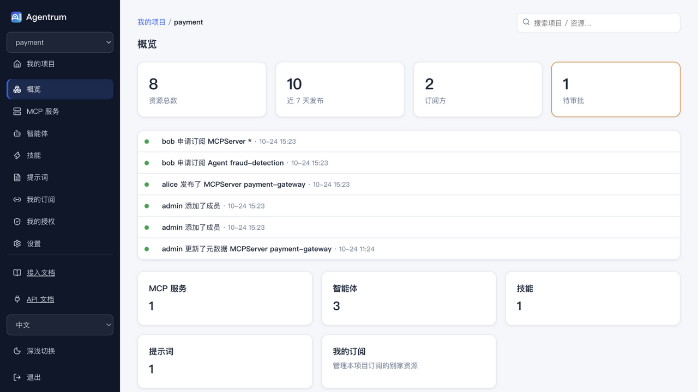
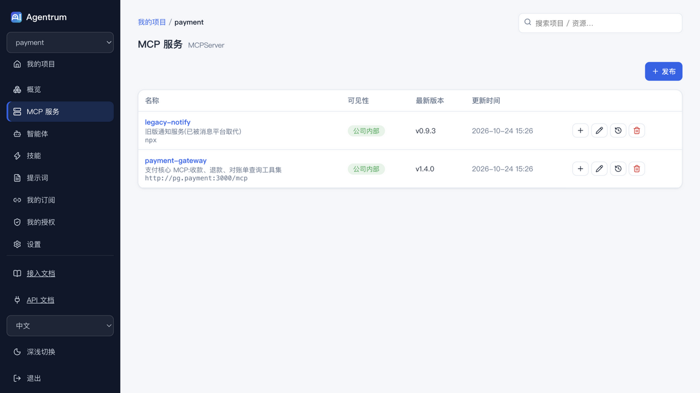
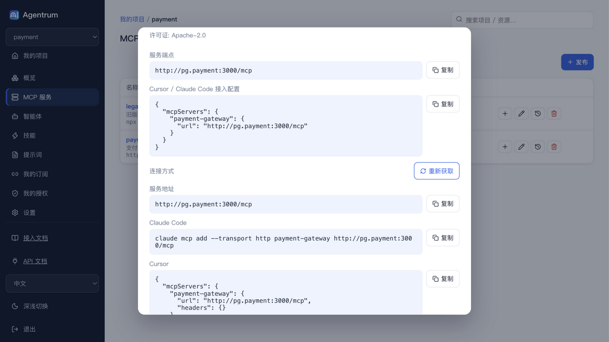
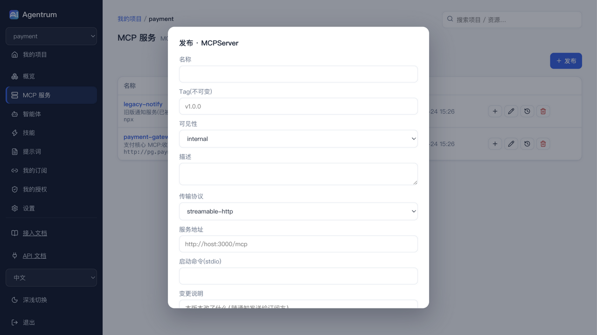
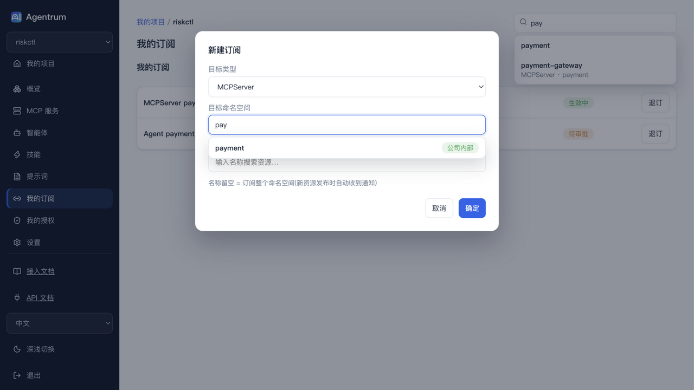
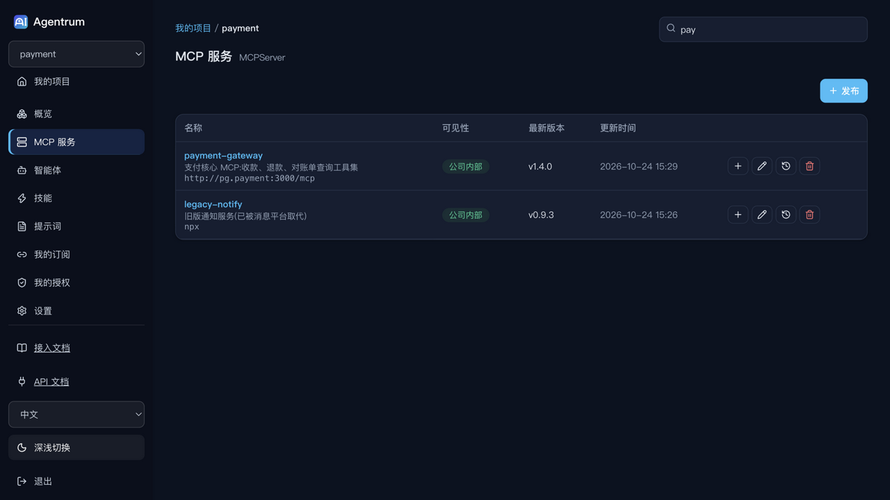
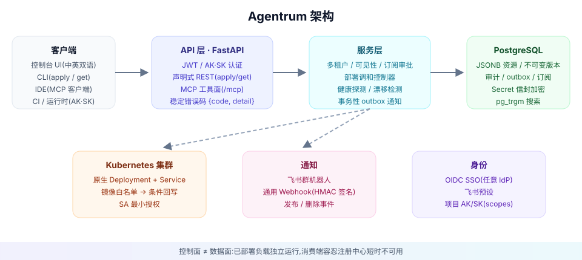

<p align="center">
  
</p>

<h1 align="center">Agentrum</h1>

<p align="center">
  <strong>多租户的企业级 AI 资产注册中心</strong><br/>
  把团队的 Agent、MCP Server、Skill、Prompt 收进一个地方:发布、订阅、部署。
</p>

<p align="center">
  
  
  
  
  <a href="README.en.md"></a>
</p>

---

## 它解决什么问题

团队里的 AI 资产散落在聊天记录、笔记本和各个仓库:没人知道哪些可信、哪个版本能用、怎么跑起来。Agentrum 给每个项目组一个**自己的空间**发布资产,给其他项目组一条**带审批的订阅**通道,再顺手把部署到 K8s 的事管起来。

| | |
|---|---|
|  |  |
| *项目概览:资源、发布、订阅方、待审批一目了然* | *资源目录:按类型组织,可见性与弃用徽章一目了然* |
|  |  |
| *资源详情:健康状态、版本时间线,一键复制 IDE 连接配置* | *发布:按类型出专属表单(MCP 支持 args/鉴权头),tag 不可变* |
|  |  |
| *跨项目订阅:可搜索选择,输入 `pay` 即筛出目标* | *深色模式(浅色默认,一键切换)* |

## 核心能力

- **多租户项目制** — 平台管理员开通项目,成员分 管理员 / 发布者 / 开发者 / 成员 四种角色(开发者可发布资源,不可删除、不可管理部署),项目即资源边界
- **AK/SK 机器凭据** — 注册、发现、调用必须携带项目级 AK/SK;scopes 控制 读取/发布/部署;SK 只显示一次、可吊销可轮换
- **跨项目订阅** — `internal` 资源直接生效;`restricted` 需属主项目审批;**Prompt 仅本项目私有**
- **不可变版本** — tag 一经发布永不移动,每次发布携带变更说明并通知订阅方
- **原生 K8s 部署** — `Deployment` 资源 + 调和控制器,镜像白名单守住"发布权≈代码执行权"的底线
- **注册中心即 MCP Server** — Cursor / Claude Code 直连 `/mcp`,在 IDE 里发现并使用公司资产
- **Git 来源的 Skill** — 发布时锁定 commit SHA,上游漂移自动标记
- **Secret 信封加密** — 值加密存储、永不回显,`env.secretRef` 注入部署
- **SSO** — 标准 OIDC(任意 IdP)+ 飞书预设;本地账号仅作引导兜底
- **内置双语文档站** — 控制台侧边栏直达,API 交互文档(`/docs`)随服务提供

## 架构

<p align="center"></p>

控制面而非数据面:已部署的负载独立运行,注册中心挂了不影响线上 Agent——消费端缓存解析结果即可。

## 快速开始

```bash
docker compose up -d --wait          # PostgreSQL + 服务(API :12122,文档 :12122/handbook/)
open http://localhost:12122/handbook # 内置接入文档
```

发布第一个资源:

```bash
pip install agentrum                 # 或源码内 uv sync 后 uv run agentrum
agentrum login --server http://localhost:12122 --username admin
agentrum init mcp-server payment-gateway && cd payment-gateway
agentrum apply agentrum.yaml
agentrum get MCPServer
```

初始账号 `admin / admin123`(**生产务必修改**)。

## 生产部署(Kubernetes)

```bash
helm upgrade --install agentrum charts/agentrum \
  --set database.url="postgresql+asyncpg://user:pass@db:5432/agentrum" \
  --set auth.secretKey="$(openssl rand -hex 32)" \
  --set auth.bootstrapAdminPassword="$(openssl rand -hex 16)" \
  --set secrets.encryptionKey="$(openssl rand -base64 32)" \
  --set deploy.imageAllowlist="registry.internal/,ghcr.io/acme/" \
  --set ingress.enabled=true --set ingress.host=registry.internal
```

双副本默认、迁移走 initContainer、探针就绪、控制器 RBAC 命名空间最小授权。更多见[运维手册](docs/site/operations.md)。

## 文档

| 你是谁 | 从这里开始 |
|---|---|
| 发布资源的开发者 | [快速开始](docs/site/quickstart.md) · [CLI 参考](docs/site/cli.md) · [资源规范](docs/site/resources.md) |
| 写脚本 / CI | [API 参考](docs/site/api.md) · [IDE 接入(MCP)](docs/site/ide.md) |
| 项目管理员 | [订阅与通知](docs/site/subscribe.md) · [SSO 接入](docs/site/sso.md) |
| 平台 / SRE | [部署接入](docs/site/deploy.md) · [运维手册](docs/site/operations.md) |

服务启动后也可访问 `/handbook/` 与 `/docs`。

## 致谢与致敬

> **本项目基于开源项目 [agentregistry](https://github.com/agentregistry-dev/agentregistry) 重构而来,在此向原作者与社区致敬。**
>
> Kubernetes 风格声明式资源模型、不可变 tag、软删除、控制器调和、注册中心暴露 MCP Server——这些设计思想都来自 agentregistry。Agentrum 是**全新 Python 实现**(FastAPI + SQLAlchemy + PostgreSQL),未复制任何上游代码;实现中的错误归我们。

## License

[Apache-2.0](LICENSE)
